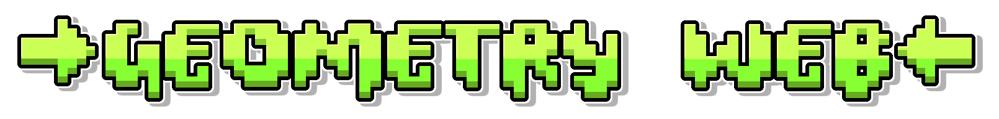

> [!NOTE]
> Geometry Web is currently under active development and is not yet complete. Some features may be unfinished, experimental, or subject to change. Please report any bugs you encounter through the Issues page on this repository. Thank you for your support!

  

  

    <strong>A fork of web dashers</strong>
  

  
  &nbsp;
  

---

## Features currently implemented:

- **Main Menu** - A functional main menu featuring the available Geometry Dash levels and navigation options.
- **Online Levels** - Browse and play online levels, as well as create your own.
- **Icon Kit** - Customize your player with different icons and colors.
- **Different Gamemodes** - Multiple Geometry Dash gamemodes with their own gameplay mechanics.
- **Extra Settings** - Customize your gameplay experience with settings such as Noclip, Show Hitboxes, and level percentage display.
- **Browser-Based Gameplay** - Play directly in your browser without needing to install the original game.

## Things currently in development:

- **Practice Mode** - Improving the existing Practice Mode to provide a more complete and reliable experience.
- **Level Editor** - Developing a more complete level editor with additional objects, tools, settings, and editing functionality.
- **Slopes** - Improving slope physics and collision behavior, including interactions with different speed portals.
- **Object Functionality** - Fixing missing animations, incorrect coloring, and other issues with existing objects.
- **Gameplay Improvements** - Refining physics, collisions, and other gameplay mechanics.

## What we hope to see added in the future:

- **Complete 2.2 Feature Support** - Expanding support for Geometry Dash 2.2 mechanics, objects, and gameplay features.
- **Swing Gamemode** - Implementing the Swing gamemode and its associated mechanics.
- **All Objects Working** - Making every supported object function correctly, including animations, colors, and interactions.
- **Advanced Trigger System** - Expanding trigger functionality to allow more complex interactions and level mechanics.
- **Custom Portals, Orbs, and Pads** - Allowing creators to configure custom gameplay objects with their own behaviors and effects.
- **Custom Gamemodes** - Providing ways to create and configure custom gameplay modes.
- **Improved Level Editor** - Adding more editing tools, object properties, and advanced creation capabilities.
- **More Customization** - Expanding the ways players can customize their gameplay and levels.

### Come try out the Geometry Web demo at:

**[web-dashers.github.io](https://web-dashers.github.io/)**

Last updated: November 6, 2026

---

> - Special thanks to everyone who contributes to Geometry Web. Please support the project by starring the repository, as it helps us out a lot!
> - Please report bugs through our Discord server or the Issues page on GitHub. Before submitting a report, check whether the issue is already known or being worked on.
